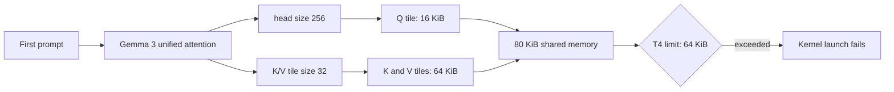
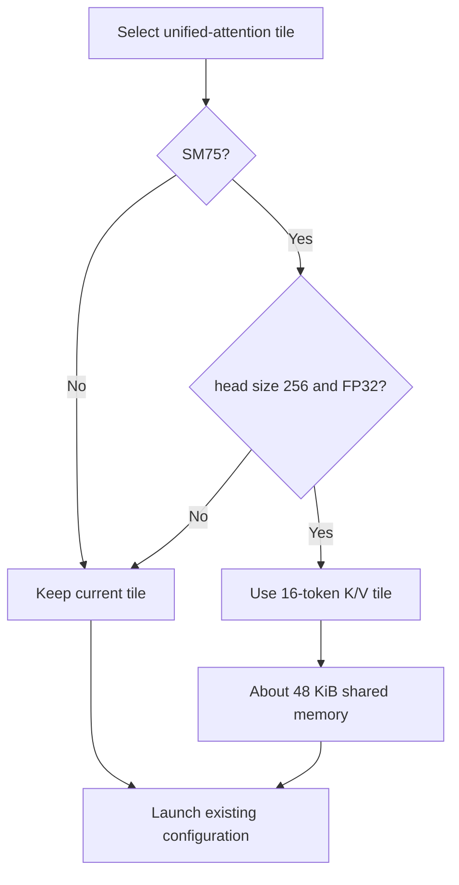
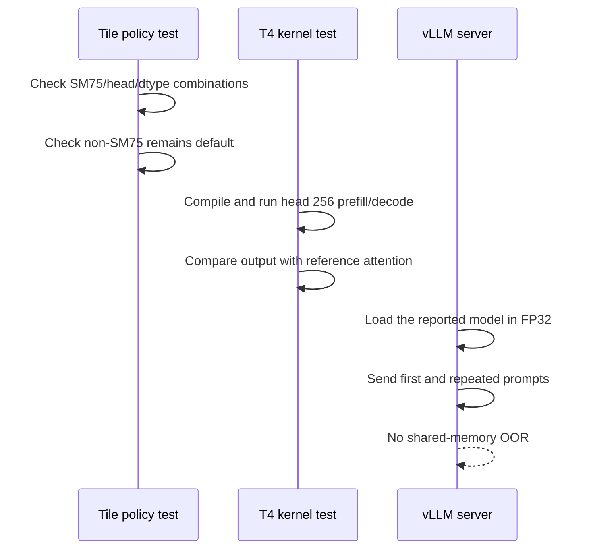

# T4 unified-attention shared-memory fix

## What I found

Issue [#36802](https://github.com/vllm-project/vllm/issues/36802) reports that
the first request to `nvidia/Nemotron-Content-Safety-Reasoning-4B` fails on
Tesla T4 with:

```text
OutOfResources: shared memory, Required: 81920, Hardware limit: 65536
```

The model has 256-wide attention heads and uses Gemma 3 sliding-window
attention. T4 cannot execute the model's BF16 dtype, so vLLM upcasts it to
FP32. Gemma 3 then selects a 32-token K/V tile in `unified_attention`.

The failing kernel has three live tiles:

- Q: `16 rows × 256 elements × 4 bytes = 16 KiB`;
- K: `256 elements × 32 tokens × 4 bytes = 32 KiB`;
- V: `32 tokens × 256 elements × 4 bytes = 32 KiB`.

Together they require exactly 80 KiB (81,920 bytes), while a T4 can provide
only 64 KiB (65,536 bytes) per block. The failure happens during kernel launch,
before any model output is produced.



## Fix

I reduce the K/V tile from 32 to 16 only when all three conditions are true:

- the device is exactly SM75;
- the attention head size is 256; and
- the query/KV element width is four bytes (FP32).

That changes the two K/V tiles from 64 KiB total to 32 KiB total. Together with
the unchanged 16 KiB Q tile, the kernel needs about 48 KiB and fits below the
T4 limit. All other devices and dtypes keep their existing tile policy.



This is deliberately a hardware-and-shape policy, not a model-name special
case. It covers the reported 256-wide FP32 attention shape on Turing without
changing the existing Gemma 3 optimization on newer GPUs or lower-precision
execution.

## Why it is safe

Tile size changes how many K/V tokens one program processes per loop
iteration, not the attention equations or output dtype. The same sequence
range is covered in twice as many iterations. Avoiding a launch-time crash is
the priority; latency must still be measured on real T4 hardware.

The policy is intentionally narrow:

| Device / head | Before | After |
| --- | --- | --- |
| SM75, FP32, head 128 | existing tile | unchanged |
| SM75, FP16/BF16, head 256 | existing tile | unchanged |
| SM75, FP32, head 256 | 32 tokens; requires 80 KiB | 16 tokens; about 48 KiB |
| Ampere, Ada, Hopper | Triton default | unchanged |
| Blackwell tuned head 256 path | 8 warps, 2 stages | unchanged |

## Reproduction evidence

I reproduced the failure and tested the fix on a Kaggle runner with two real
Tesla T4 GPUs. The notebook is available at
[`placideo/vllm-36802-full-model-t4-reproduction`](https://www.kaggle.com/code/placideo/vllm-36802-full-model-t4-reproduction).

The run used the issue's exact vLLM commit (`95c0f928`), vLLM 0.17.1, Torch
2.10.0+cu128, Triton 3.6.0, and the reported Nemotron model. Because Kaggle
provides two T4s rather than the reporter's four, I used tensor parallelism 2
plus 4 GiB CPU offload and disabled the hybrid KV-cache manager. Those settings
make the FP32 model fit; they do not change the attention head width, element
size, Triton kernel, or per-block shared-memory limit under test.

| Run | Source policy | Result |
| --- | --- | --- |
| Baseline | 32-token tile | OOR: 81,920 > 65,536 bytes |
| Patched | SM75, FP32, h=256: tile 16 | Passed; generated 32 tokens |

The patched run completed with exit code 0 and without a shared-memory OOR.
The baseline and patched runs used the same model, prompt, engine arguments,
and GPU pair. Kaggle's driver was 580.159.04 rather than the issue's
535.161.07, so the reproduced byte-for-byte allocation demonstrates that the
failure is kernel-shape dependent rather than specific to the older driver.

## Verification plan



### Repository checks

Run from the repository root:

```bash
uv run --active pre-commit run --files \
  vllm/v1/attention/ops/triton_unified_attention.py \
  tests/kernels/attention/test_triton_unified_attention.py \
  docs/design/t4_triton_unified_attention_shared_memory.md

uv run --active pytest -q \
  tests/kernels/attention/test_triton_unified_attention.py \
  -k 't4_large_head_tile_size'
```

### T4 kernel regression

On an SM75 runner, use FP32 for query and KV cache. This is the actual path in
the report: vLLM automatically upcasts the model from BF16 to FP32 on T4.

```bash
uv run --active pytest -q \
  tests/kernels/attention/test_triton_unified_attention.py \
  -k 't4_large_head_shared_memory'
```

The acceptance criteria are:

1. no `triton.runtime.errors.OutOfResources` during compilation or launch;
2. kernel output remains within the existing reference tolerances;
3. head-size-128 coverage remains green;
4. peak latency and throughput are recorded before and after the change.

### Reported-model smoke test

```bash
vllm serve nvidia/Nemotron-Content-Safety-Reasoning-4B \
  --dtype float32 \
  --kv-cache-dtype auto \
  --tensor-parallel-size 2 \
  --gpu-memory-utilization 0.8 \
  --max-model-len 4096 \
  --enforce-eager
```

Then send at least one short prompt and one prompt long enough to exercise the
sliding-window path. A two-GPU T4 runner is sufficient for the resource
regression: tensor parallelism changes the local head counts but not the
256-wide head dimension or the SM75 per-block shared-memory limit.

## Risk and rollback

The primary risk is a T4 latency regression from processing smaller K/V tiles.
Record time-to-first-token and inter-token latency during the smoke test. If
the regression is unacceptable, the next tuning step should benchmark
alternate tile and block shapes rather than silently restoring the
configuration that cannot launch.

Rollback is a single tile-policy change in `_get_tile_size` plus its tests. No
cache format, serialized state, or public API changes are involved.
