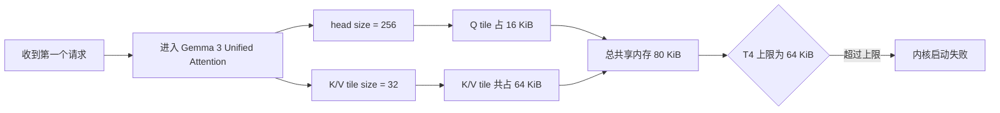
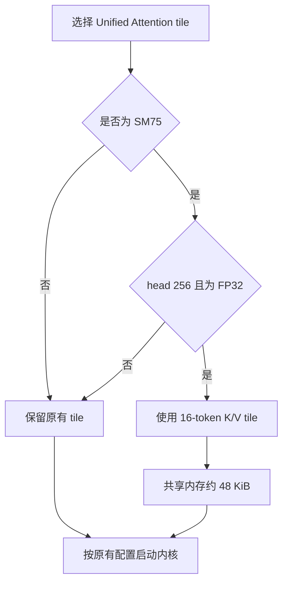
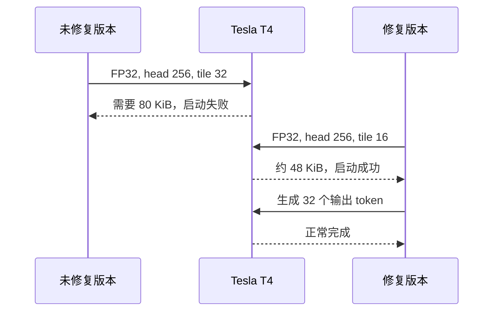
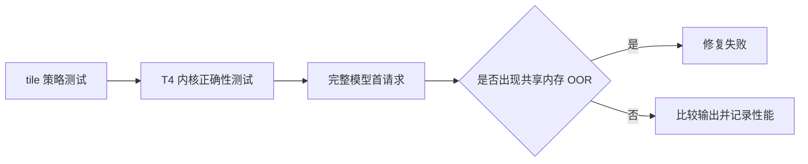

# T4 Unified Attention 共享内存溢出修复方案

## 我定位到的问题

vLLM issue
[#36802](https://github.com/vllm-project/vllm/issues/36802)
反馈：在 Tesla T4 上运行
`nvidia/Nemotron-Content-Safety-Reasoning-4B` 时，首个请求失败：

```text
OutOfResources: shared memory, Required: 81920, Hardware limit: 65536
```

这个模型的 attention head size 是 256，并使用 Gemma 3 的滑动窗口
attention。模型原始 dtype 是 BF16，但 T4 不支持 BF16，vLLM 会自动将它
提升为 FP32。随后，Gemma 3 的优化策略为 Unified Attention 选择了长度
为 32 的 K/V tile。

失败内核需要同时保留三块 tile：

- Q：`16 行 × 256 元素 × 4 字节 = 16 KiB`；
- K：`256 元素 × 32 token × 4 字节 = 32 KiB`；
- V：`32 token × 256 元素 × 4 字节 = 32 KiB`。

三者合计正好是 80 KiB，也就是 81,920 字节；但 T4 每个 block 最多
只能使用 64 KiB，也就是 65,536 字节。因此内核在 launch 阶段就失败，
模型还没有机会生成任何内容。



## 修复方案

我只在下面三个条件同时满足时，将 K/V tile 从 32 缩小到 16：

- 设备架构是 SM75；
- attention head size 是 256；
- Query 和 KV 的元素宽度是 4 字节，也就是 FP32。

这样一来，两块 K/V tile 的总占用从 64 KiB 降到 32 KiB。加上保持
不变的 16 KiB Q tile，整个内核大约需要 48 KiB，共享内存能够落在
T4 的 64 KiB 限制以内。

其他 GPU、其他 dtype 和其他 head size 都继续使用原来的 tile 策略。



这里没有根据模型名称做硬编码，而是根据真正导致问题的硬件和张量
形状做选择。这样既覆盖了 issue 中的 Gemma 3 模型，也不会影响新架构
GPU 上原有的 Gemma 3 优化或较低精度的执行路径。

## 为什么不是修改 `num_stages`

我最开始也验证了 Triton 错误信息建议的 `num_stages=1`，但完整模型
仍然请求 81,920 字节共享内存。原因是这 80 KiB 来自内核中同时存活的
Q、K、V tile，而不是多级软件流水线额外复制出来的缓存。

所以，降低 pipeline stage 并不能改变这次分配。真正有效的控制量是
K/V tile size。这个失败实验也保留在排查记录中，避免后续又走回同一条
无效路径。

## 影响范围

tile size 只改变每次循环处理多少个 K/V token，不会改变 attention
公式、覆盖的序列范围或输出 dtype。同一个序列范围会通过更多次循环
完成计算。

| 设备与输入 | 修复前 | 修复后 |
| --- | --- | --- |
| SM75、FP32、head 128 | 原有 tile | 不变 |
| SM75、FP16/BF16、head 256 | 原有 tile | 不变 |
| SM75、FP32、head 256 | tile 32，需要 80 KiB | tile 16，约 48 KiB |
| Ampere、Ada、Hopper | 原有策略 | 不变 |
| Blackwell head 256 优化路径 | 8 warps、2 stages | 不变 |

## 真实 T4 复现与验证

我在 Kaggle 的两张真实 Tesla T4 上完成了基线复现和修复验证。Notebook
位于：
[`placideo/vllm-36802-full-model-t4-reproduction`](https://www.kaggle.com/code/placideo/vllm-36802-full-model-t4-reproduction)。

验证采用 issue 对应的完整模型和软件栈：

- vLLM commit：`95c0f928cdeeaa21c4906e73cee6a156e1b3b995`；
- vLLM：0.17.1；
- PyTorch：2.10.0+cu128；
- Triton：3.6.0；
- 模型：`nvidia/Nemotron-Content-Safety-Reasoning-4B`；
- GPU：2 × Tesla T4，Compute Capability 7.5；
- 实际 attention dtype：FP32。

原报告使用四张 T4，而 Kaggle 提供两张。为了让 FP32 模型能装入两张
卡，我使用 tensor parallel 2、4 GiB CPU offload，并关闭 hybrid KV
cache manager。这些设置只解决模型容量问题，不会改变被测试内核的
head size、元素宽度或 T4 的单 block 共享内存上限。

| 运行 | tile 策略 | 结果 |
| --- | --- | --- |
| 基线 | tile 32 | 首个请求失败：81,920 > 65,536 字节 |
| 修复版 | SM75、FP32、head 256 使用 tile 16 | 成功生成 32 token |

修复版退出码为 0，没有再次出现共享内存 OOR。基线和修复版使用了
完全相同的模型、prompt、引擎参数和 GPU。

Kaggle 驱动版本是 580.159.04，原报告是 535.161.07。两个环境都得到
完全相同的 81,920 字节分配，说明这个问题由内核形状决定，并不是旧版
驱动独有的问题。



## 测试设计

我把测试分成三个层次：

1. tile 策略单元测试：确认只有目标硬件和形状选择 tile 16；
2. T4 内核回归测试：编译并运行 FP32、head 256 的 prefill/decode；
3. 完整模型测试：加载报告中的 Nemotron 模型并真正生成内容。



仓库检查命令：

```bash
uv run --active pre-commit run --files \
  vllm/v1/attention/ops/triton_unified_attention.py \
  tests/kernels/attention/test_triton_unified_attention.py \
  docs/design/t4_triton_unified_attention_shared_memory.md \
  docs/design/t4_triton_unified_attention_shared_memory_zh.md

.venv/bin/python -m pytest -q \
  tests/kernels/attention/test_triton_unified_attention.py \
  -k 't4_large_head_tile_size or t4_large_head_shared_memory'
```

验收标准：

1. 编译和启动阶段不再出现 `triton.runtime.errors.OutOfResources`；
2. 内核输出满足现有 reference attention 的误差要求；
3. SM75、FP32、head 256 以外的 tile 策略保持不变；
4. 完整模型能够完成首次及后续请求；
5. 提交前记录修改前后的首 token 延迟和吞吐变化。

## 风险与回滚

主要风险是 T4 上处理更小的 K/V tile 可能带来延迟或吞吐回退。完整
模型验证已经证明它能从“无法运行”变为“正常生成”，但在合入前仍应
补充稳定的性能数据。

如果性能回退不可接受，下一步应继续测试其他 tile 和 block 组合，而
不是恢复到无法启动的 tile 32 配置。

回滚范围很小：撤销 `_get_tile_size` 中的 SM75 FP32 tile 策略和对应测试
即可，不涉及 KV cache 格式、持久化状态或公共 API。
